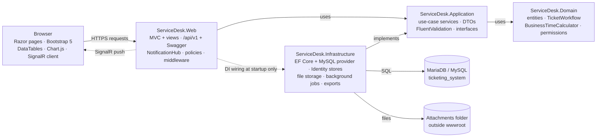
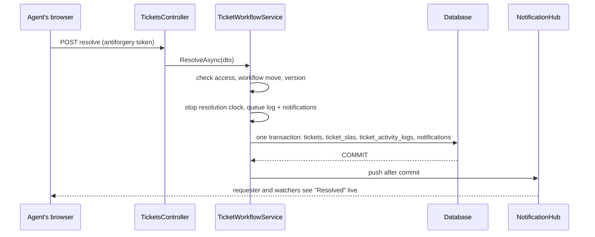
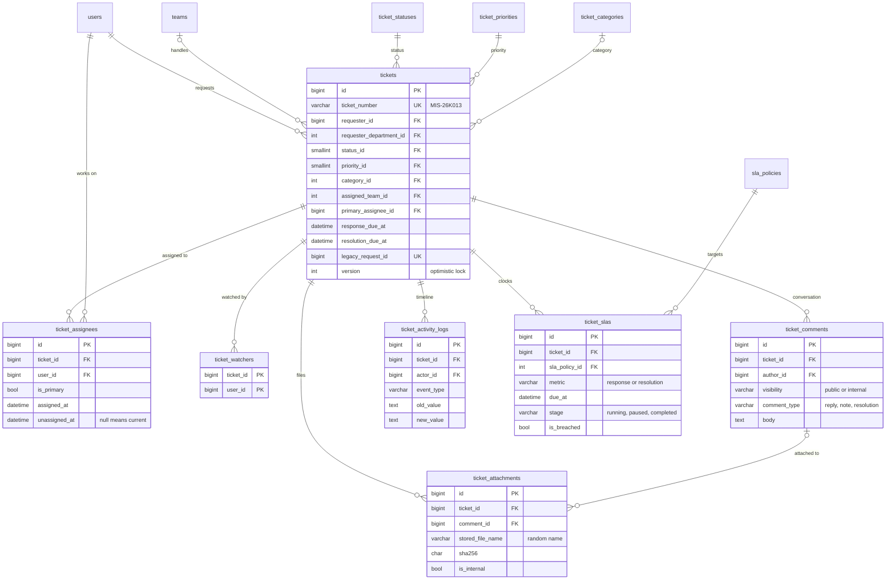
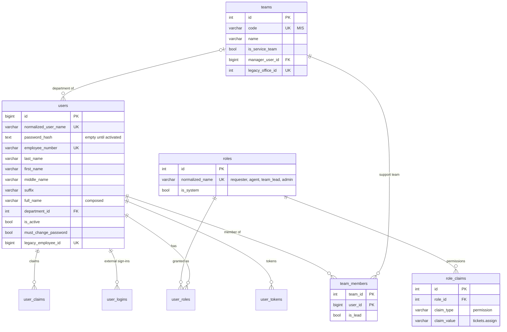
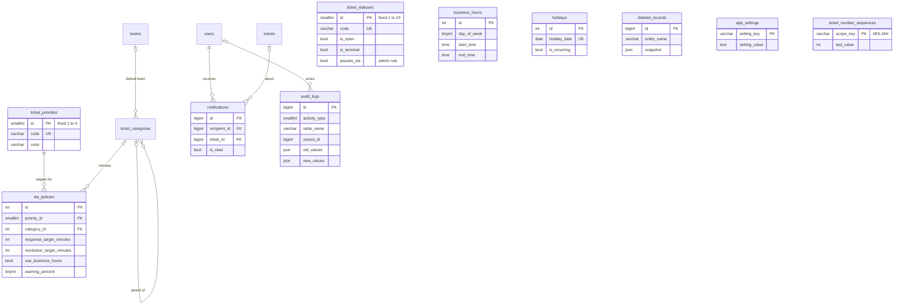
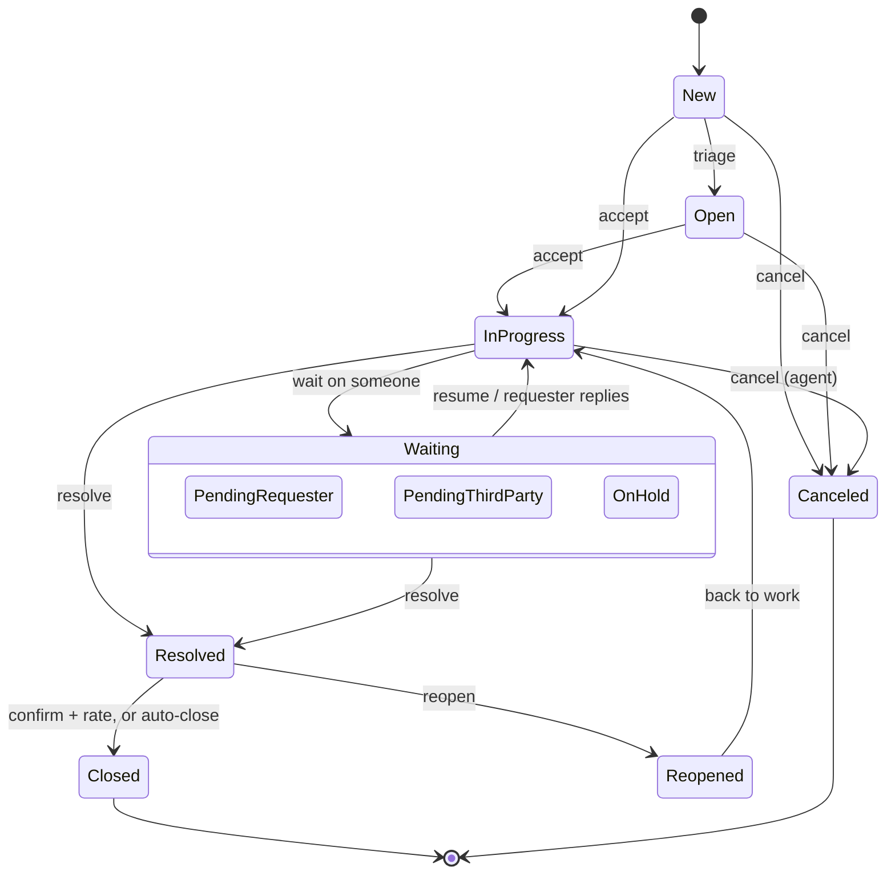

# ServiceDesk architecture

The help desk that replaces the legacy `rqst` request log. This is the design approved on
20 November 2026; the visual review page with the same content is at
<https://claude.ai/artifact/CLYL99SwyCqE47ibVZwyGx>.

## Decisions (accepted 20 Nov 2026)

| # | Decision | Choice |
|---|---|---|
| D1 | EF Core provider and database | `Microting.EntityFrameworkCore.MySql` 10.0.x, a maintained fork of Pomelo that supports EF Core 10 with MySQL and MariaDB. Develop on XAMPP MariaDB 10.4.32; run production on MariaDB 10.11 / 11.4 LTS or MySQL 8.4 LTS (MariaDB 10.4 has had no security fixes since June 2024). Pomelo 9.0.0 has no EF Core 10 build; Oracle's provider is MySQL-only. |
| D2 | Schema source of truth | EF Core migrations. Each migration is also exported as an idempotent SQL script in `database/` for DBA-run installs and upgrades. The legacy import stays hand-written SQL. |
| D3 | Ticket numbers | Keep the legacy format: `MIS-26K013` = team code, two-digit year, month letter (A = January … L = December), sequence within the month. New tickets continue after the last migrated number. Numbers come from a row-locked counter (`ticket_number_sequences`) inside the create transaction. |
| D4 | First sign-in for imported employees | Admin activation: imported accounts have no password; an admin activates people (one at a time or a whole office) and the system shows a one-time temporary password. The first sign-in forces a new password. |
| D5 | SLA clock | Business hours (Mon–Fri 08:00–12:00 and 13:00–17:00, Asia/Manila, holidays skipped) for Low, Medium and High, where a "day" is one 8-hour business day. Critical runs on the 24×7 clock. Admins can change policies later. |

Also accepted: working name **ServiceDesk** (database `ticketing_system`); the solution lives in the
project root; legacy times are Philippine local time (UTC+8) and are stored as UTC; requesters pick
Low–High and only agents and above set Critical; v1 notifications are in-app and real-time (email
sits behind an interface for later); Bootstrap 5 replaces the hand-built CSS of the EPES flow while
its shell conventions carry over; one Git commit per phase.

## Layers

Project references point inward: Web → Application → Domain, and Infrastructure → Application.
Web references Infrastructure only to register it at startup, so no controller reaches the
DbContext directly.

* Services are split by use case (creation, workflow, assignment, comments, queries) instead of one
  large ticket service.
* Repository and unit of work as in the EPES flow: a generic repository, dedicated repositories only
  where ticket queries get heavy, one `SaveChangesAsync` per use case; flows that save twice run in
  an explicit transaction.
* Application references `Microsoft.EntityFrameworkCore` for async LINQ on repository queries, never
  the DbContext or the provider. This is a deliberate trade-off.
* Domain references `Microsoft.Extensions.Identity.Stores` so `User` and `Role` extend
  `IdentityUser<long>` / `IdentityRole<long>` and ticket foreign keys point at a real user entity.
* Mapping is hand-written; no AutoMapper, no MediatR.
* `/api` paths answer 401/403 and problem details instead of redirects and HTML pages.

### One write, one transaction

A status change runs every check first, then saves the ticket, its SLA clock, its timeline entry
and its notifications in one transaction. Real-time pushes go out only after COMMIT.

## Data model

27 tables. Names are snake_case with `id` keys, as in `ticketing-system/schema.sql`. Every time is
stored in UTC. Tickets and users are never deleted (tickets are canceled, users deactivated);
reference data is soft-deleted into a Recycle Bin.

### Tickets

### People and access

### Configuration, notifications and system

### Changes from `ticketing-system/schema.sql`

| Area | schema.sql | Now | Why |
|---|---|---|---|
| Accounts | `users`, `roles`, `user_roles` with a plain hash | Same tables with ASP.NET Core Identity columns, plus `user_claims`, `user_logins`, `user_tokens`, `role_claims` | Identity; permissions live in role claims |
| Teams | `users.team_id` | `users.department_id` plus `team_members` (with `is_lead`) | An agent can serve several teams; leads are explicit |
| Assignment | key on ticket + user | Own id with `assigned_at`/`unassigned_at`; generated columns enforce one active row per person and one active primary | Full assignment history |
| SLA | `due_at`; targets on priorities and policies | `ticket_slas` (one row per clock), `business_hours`, `holidays`, `ticket_statuses.pauses_sla`; targets only in `sla_policies` | Pause/resume, breaches, compliance reports |
| Workflow | — | `resolved_by_id`, `closed_by_id`, `close_reason`, `canceled_at/by`, `last_reopened_at`, `version` | Accountability, optimistic concurrency |
| New tables | — | `notifications`, `audit_logs`, `deleted_records`, `app_settings`, `ticket_number_sequences` | Bell, audit trail, Recycle Bin, settings, numbering |
| Keys | UNSIGNED | Signed BIGINT/INT | C# long/int, as Identity expects |
| Legacy | `noted_by_*`, `approved_by_*`, `turnaround_*`, `is_archived` | Kept, marked legacy | Old records stay complete |

## Ticket workflow

Statuses inside **Waiting** pause the SLA clock by default (`ticket_statuses.pauses_sla`, editable).
Closed and Canceled are final; a recurring problem becomes a new ticket.

| Move | Who | Rule |
|---|---|---|
| New → Open | Agent in the team, team lead | Triage confirms category, priority and team. Assigning also opens. |
| New/Open → In Progress | Assignee (Accept) | Stops the response clock if still running. |
| → Pending Requester / Third Party / On Hold | Assignee, team lead | Needs a reason; pauses SLA clocks. |
| Pending Requester → In Progress | Automatic | When the requester replies. |
| → Resolved | Assignee, team lead | Needs a resolution code and a public resolution note. |
| Resolved → Closed | Requester, System | Confirm and rate 1–5, or auto-close after 3 days (setting). |
| Resolved → Reopened | Requester before auto-close, assignee, team lead | Needs a reason; resumes the resolution clock. |
| → Canceled | Requester (own, before work starts), agent, team lead | Needs a reason. |

First response is the earliest of: the assignee accepts, the first public reply from someone other
than the requester, or resolution.

## Roles and permissions

| Capability | Permission | Requester | Agent | Team lead | Admin |
|---|---|:-:|:-:|:-:|:-:|
| Create tickets | `tickets.create` | ✓ | ✓ on behalf | ✓ | ✓ |
| See tickets | `tickets.view.team` · `.all` | own and watched | + assigned and team queues | + teams they lead | all |
| Internal notes | `tickets.internal_notes` | — | ✓ | ✓ | ✓ |
| Workflow moves | `tickets.workflow` | confirm, reopen, cancel own | ✓ | ✓ | ✓ |
| Pick up from team queue | `tickets.assign.self` | — | ✓ | ✓ | ✓ |
| Assign and reassign | `tickets.assign` | — | — | ✓ | ✓ |
| Change priority | `tickets.priority` | Low–High when filing | — | ✓ | ✓ |
| Edit subject and category | `tickets.edit` | own, while New | ✓ | ✓ | ✓ |
| Team reports and workload | `reports.team` | — | — | ✓ | ✓ |
| System-wide reports | `reports.all` | — | — | — | ✓ |
| Users, teams, categories | `users.manage` · `teams.manage` · `catalog.manage` | — | — | — | ✓ |
| SLA, business hours, holidays | `sla.manage` | — | — | — | ✓ |
| Roles, permissions, settings | `roles.manage` · `settings.manage` | — | — | — | ✓ |
| Audit log, Recycle Bin | `audit.view` · `recyclebin.manage` | — | — | ticket timelines | ✓ |

Permissions are role claims, turned into cookie claims at sign-in and checked by policies.
Ticket access is resource-based: every list, search, export and API query goes through one
`TicketAccessScope` filter, so a guessed ticket id returns 404. Internal notes never leave the server
for users without internal access.

## SLA engine

| Priority | Response | Resolution | Clock |
|---|---|---|---|
| Low | 24 business hours | 5 business days | Business hours |
| Medium | 8 business hours | 2 business days | Business hours |
| High | 2 business hours | 1 business day | Business hours |
| Critical | 30 minutes | 8 hours | 24×7 |

* **Attach.** On create, the most specific active policy applies (category + priority, then priority).
  Two `ticket_slas` rows are created, one per clock.
* **Pause and resume.** Entering a status with `pauses_sla` pauses running clocks; leaving resumes them
  and pushes the due time out by the paused business time.
* **Stop.** Response stops at first response; resolution stops at Resolved and resumes on reopen.
* **Re-target.** A priority change cancels running clocks and starts new ones from the original start.
* **Monitor.** `SlaMonitorService` runs every 60 seconds: one warning at 75 %, one breach alert at 100 %,
  each claimed by a conditional UPDATE so two servers never send it twice.
* **Auto-close.** `AutoCloseService` closes tickets left in Resolved for 3 days, as System.

Example: a High ticket on business hours filed Friday 16:00 has its response due Monday 09:00.
Three business hours in Pending Requester move its resolution due time from Monday 16:00 to Tuesday 10:00.

## Security controls

* **Sign-in:** Identity hashing (PBKDF2); passwords of 10+ characters with upper, lower and digit;
  lockout for 15 minutes after 5 failures; a sign-in rate limit per IP; forced change at first
  sign-in; deactivation changes the security stamp (signed out within 5 minutes); HttpOnly, Secure,
  SameSite=Lax cookie with 8-hour sliding expiry; persisted Data Protection keys.
* **Authorization:** sign-in required by default; permission policies; resource-based ticket checks;
  `TicketAccessScope` under every ticket query; internal notes filtered on the server.
* **Input and output:** antiforgery on every unsafe method (form field or `RequestVerificationToken`
  header); parameterized EF Core queries; sort columns mapped through an allowlist; FluentValidation
  on every write; Razor encoding; comments stored and shown as plain text.
* **Headers** (built in Phase 1): Content-Security-Policy without inline scripts, nosniff,
  `X-Frame-Options: DENY` and `frame-ancestors 'none'`, Referrer-Policy, Permissions-Policy,
  Cross-Origin-Opener-Policy, `Cache-Control: no-store` on pages, HSTS in production, no `Server` header.
* **Attachments:** 10 MB per file, 5 per post, extension allowlist checked against file signatures,
  random names outside wwwroot, SHA-256, authorized downloads only.
* **Audit:** `audit_logs` and `ticket_activity_logs` are append-only (the app's database user has
  INSERT and SELECT only); never passwords or tokens.
* **Operations:** least-privilege database user; migrations run as a deploy user; secrets in
  user-secrets (development) and environment variables (production); friendly errors and problem
  details in production; Serilog rolling files; `/health`.

## Legacy migration from rqst

`rqst.sql` (MariaDB 10.4.32 dump): 65 offices (MIS is the only handling office), 788 employees,
1,124 requests from June 2024 to November 2026.

| rqst status | Requests | New status |
|---|--:|---|
| rated | 973 | Closed |
| VOID / void | 139 | Canceled |
| created | 6 | New |
| completed | 4 | Resolved |
| assigned | 2 | In Progress |

Problems the new import script must handle (the current `ticketing-system/migrate_from_rqst.sql`
has the first two as bugs):

| Finding | If ignored | Fix |
|---|---|---|
| The tickets INSERT…SELECT returns noted_by/approved_by names and ids in swapped positions | Names stored as numbers, ids as 0 (strict mode and FK checks are off) | Explicit column order; FK checks stay on |
| 108 employees share the placeholder number "0" | `ON DUPLICATE KEY UPDATE` merges them into one user; up to 657 request links break | "0" and blanks become NULL; username falls back to `emp-<legacy id>`; `legacy_employee_id` is the only match key |
| 239 `date_received` and 262 `date_completed` values have no time; 217 and 206 fall before the request | Negative response and resolution times | Clamp to the request time; leave legacy tickets out of response-time averages |
| Request times cluster 08:00–17:00 (local) | Times 8 hours off | Subtract 8 hours on import |
| `handling_office_id` is empty on all requests | No team | Route every legacy ticket to MIS |
| 27 descriptions exceed 255 characters | Subject overflow | Cut the subject at a word boundary; keep the full description |
| One requester id matches no employee | Missing requester | Keep the name snapshot |
| Ratings: 966 fives, 11 fours, 147 none | Legacy average swamps new ratings | Report legacy and new satisfaction separately |

Legacy tickets get no SLA clocks; they count in volume, satisfaction and resolution-time reports but
not SLA compliance. The ticket-number counter is seeded so the next November 2026 ticket is `MIS-26K013`.

## Build plan

| Phase | Scope | Done when |
|---|---|---|
| 1 Foundation | Solution, build rules, Program.cs, logging, errors, security headers, health, UI shell, UI kit | Build and tests pass with no warnings; the shell runs on desktop and phone |
| 2 Database and entities | 27 entities, configurations, InitialCreate migration + SQL export, seeder, legacy import | Empty database builds from migrations; import gives 65 teams, 788 users, 1,124 tickets |
| 3 Sign-in and access control | Identity, forced password change, permission claims and policies, ticket access scope, roles page | Each role reaches exactly what the matrix allows |
| 4 Users, teams, reference data | Users and activation, teams, categories, labels, audit log page, Recycle Bin | Every change appears in the audit log with before/after values |
| 5 Tickets | Create, numbering, list with server-side paging, search, details, workflow moves, `/api/v1/tickets` | Requester-to-agent round trip; 50 parallel creates get 50 numbers |
| 6 Assignment, conversation, history | Assign, accept, replies, internal notes, attachments, watchers, timeline, resolve/confirm/reopen | Full workflow end to end; requesters never get internal notes |
| 7 SLA and notifications | SLA admin pages, SLA engine, monitor, auto-close, bell, SignalR | Calculator tests pass; breach alerts appear live |
| 8 Dashboards and reports | Role dashboards, charts, reports, Excel/PDF/CSV export | Figures match SQL checks on migrated data |
| 9 Security testing and performance | Access matrix, CSRF, upload abuse, ZAP scan, query tuning, 50k-ticket load | No high findings; ticket list under 300 ms at 50k tickets |
| 10 Deployment and documentation | IIS guide, grants, migration bundle, backups, user and admin guides | A clean install works from the documents alone |

## Testing

* **Unit** (xUnit v3): workflow moves per role, business-time calculator, ticket numbers, names,
  validators, permission matrix, services with fakes.
* **Integration:** `WebApplicationFactory` in memory; from Phase 2 against a throwaway
  `ticketing_system_test` database on the local server (Docker isn't installed).
* **Manual:** role-by-role acceptance scripts in `docs/testing.md`; phone checks at 390×844 and 360×740.

## Deployment target

Windows Server with IIS and the ASP.NET Core 10 Hosting Bundle (Linux + Nginx also works). App pool:
No Managed Code, Start Mode AlwaysRunning, Idle Time-out 0, Preload Enabled, so background jobs keep
running. Configuration from environment variables; Data Protection keys and attachments outside the
site; nightly mysqldump plus an attachments backup.
